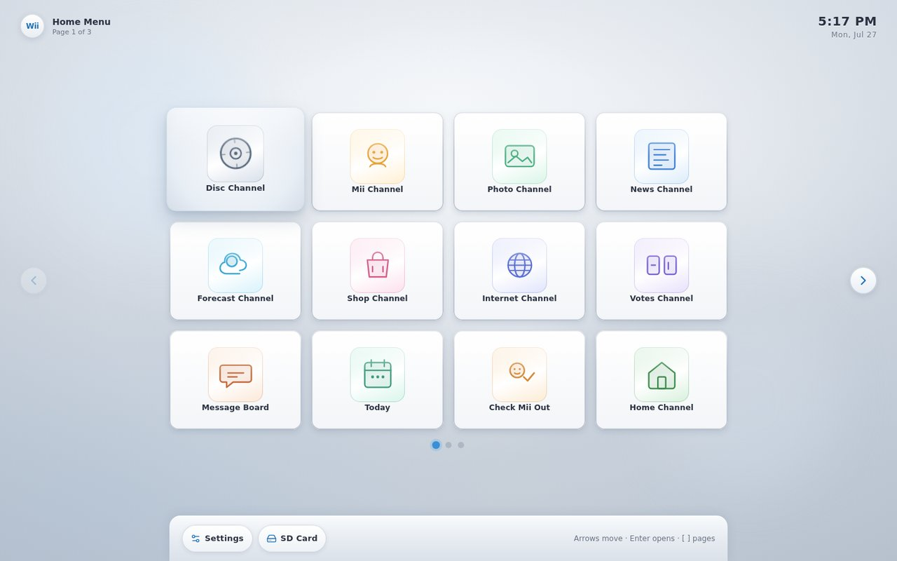
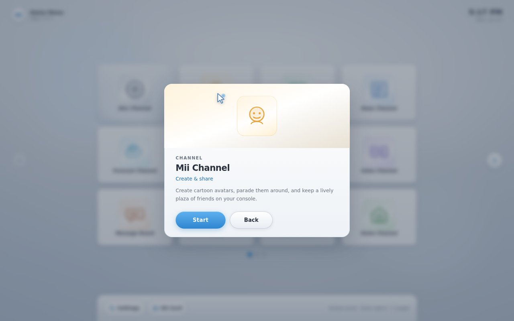
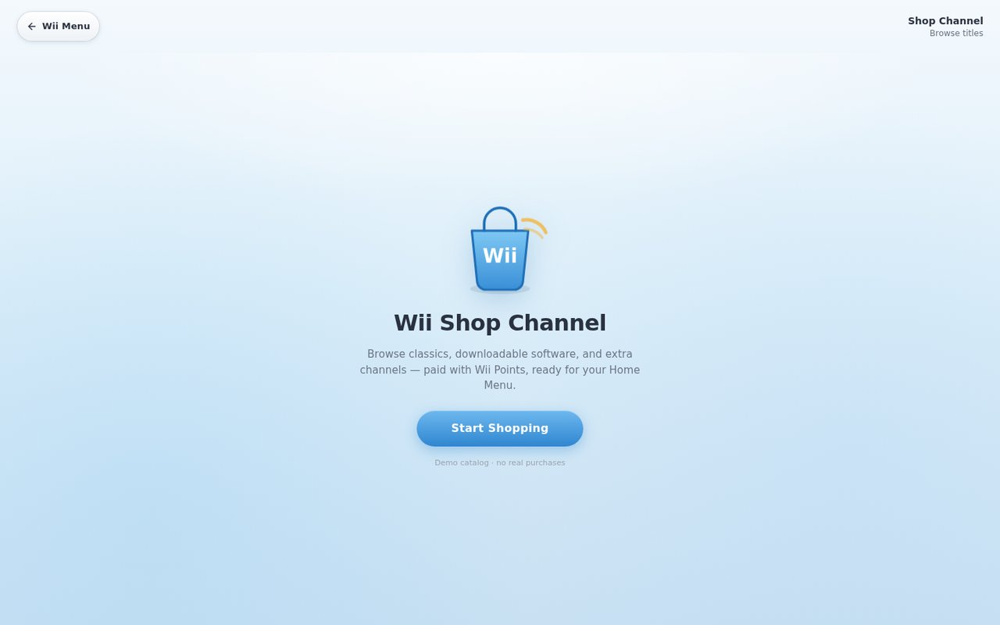
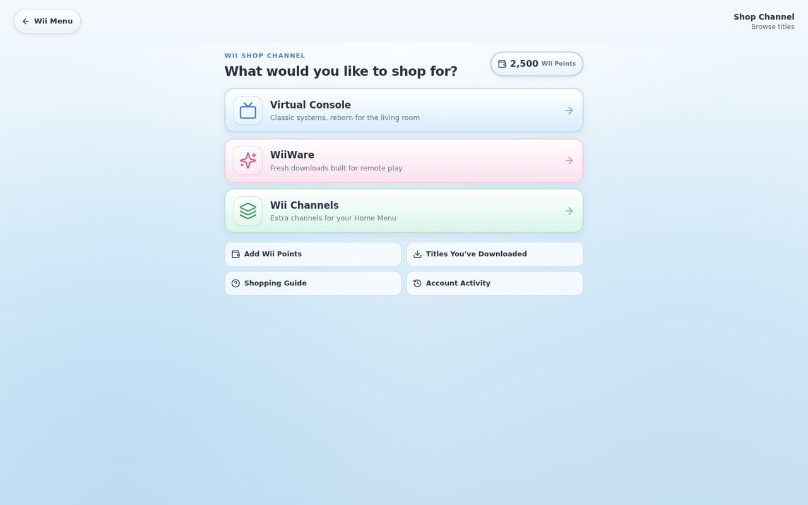
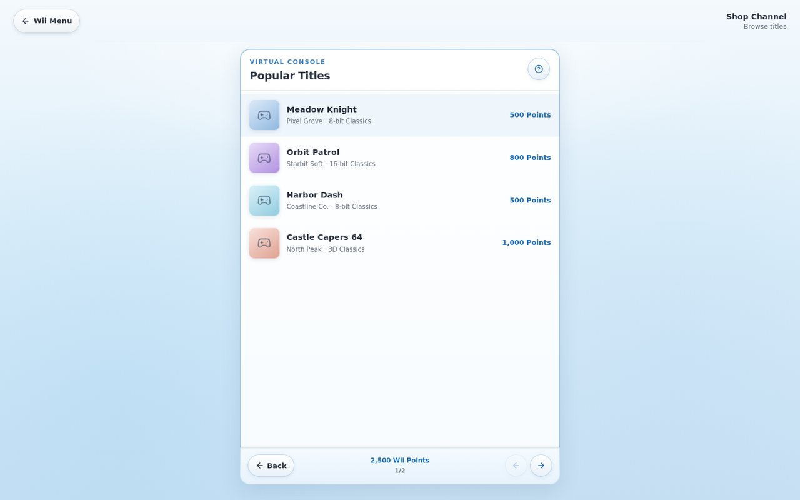
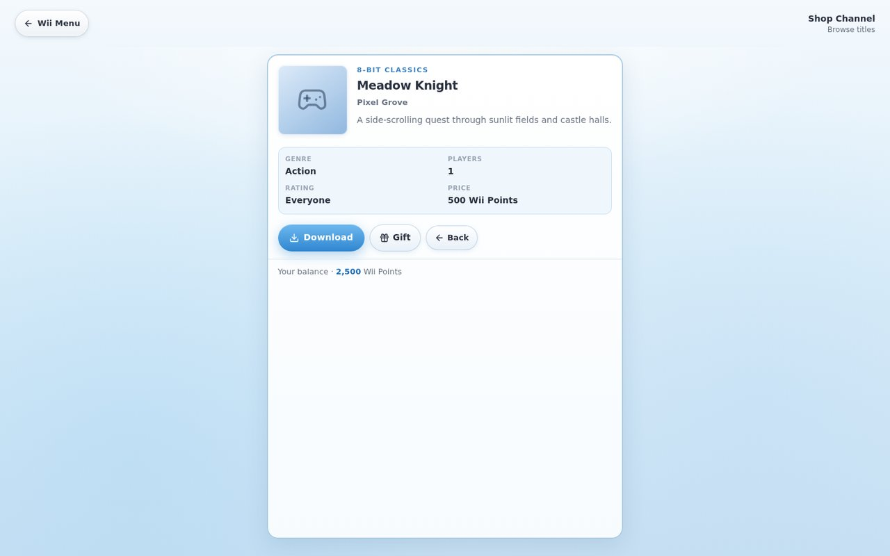
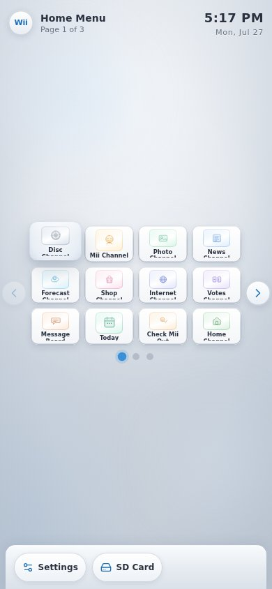

# Wii Home Menu

A polished **fan recreation** of the classic Wii System Menu — soft ambient chrome, multi-page channel grid, pointer cursor, light UI sounds, and a full **Shop Channel** browse flow.

> Not affiliated with Nintendo. Original demo catalog and channel art only.

<p align="center">
  
</p>

<p align="center">
  <em>The Home Menu — channel tiles, page dots, Settings & SD Card bar</em>
</p>

## Features

- Living-room **Home Menu** with a 4×3 channel grid across multiple pages  
- Soft hover focus rings, custom desktop pointer, and Web Audio beeps  
- Keyboard navigation (arrows, Enter, Esc, `[` `]`)  
- Channel experiences: Disc, Mii Plaza, Photo, News, Forecast, Internet, Votes, Message Board, and more  
- **Shop Channel** — Start Shopping → categories → title lists → download with demo Wii Points  
- **Remembers where you were** — menu position/focus, audio volume/mute, and the Shop Channel's Wii Points balance + owned titles all persist across reloads via `localStorage`  
- Responsive layout for desktop and phone  

## Screenshots

### Channel open

<p align="center">
  
</p>

### Shop Channel

| Welcome | Category hub |
| :-----: | :----------: |
|  |  |

| Popular Titles | Title detail |
| :------------: | :----------: |
|  |  |

### Mobile

<p align="center">
  
</p>

## Stack

- React 19 + TypeScript  
- Vite + TanStack Start / Router  
- Tailwind CSS v4  

## Run locally

```bash
npm install
npm run dev
```

App serves on [http://localhost:8080](http://localhost:8080).

```bash
npm run build      # production build
npm run typecheck  # TypeScript
npm test           # vitest unit tests
```

CI (GitHub Actions) runs the same four checks — typecheck, lint, test, build — on every push to `main` and on all pull requests.

## Controls

| Input | Action |
| --- | --- |
| Arrow keys | Move channel focus |
| Enter / Space | Open focused channel |
| Esc | Back / close |
| `[` `]` or page arrows | Previous / next channel page |
| Pointer / touch | Hover, open tiles, Shop navigation |

### Shop flow

1. Open **Shop Channel** → **Start**  
2. **Start Shopping**  
3. Pick **Virtual Console**, **WiiWare**, or **Wii Channels**  
4. Browse **Popular Titles**, open a row, **Download** (demo Wii Points) or **Gift**  

## i18n

All Home Menu + Shop Channel UI copy flows through a tiny `t(key, vars?)` resolver instead of hardcoded English strings.

- **`t(key, vars?)`** resolves a dot-namespaced key (e.g. `shop.toast.downloaded`) against the active locale's message map and interpolates `{placeholder}` slots from `vars`. Unknown keys fall back to the key itself so a missing translation is visible, not silent.
- **The active locale lives in a zustand store** (`src/lib/i18n/`), so `t()` works inside components *and* outside React (event handlers, toasts).
- **English ships by default** (`en.ts`). Data arrays carry `*Key` fields (e.g. `nameKey: "channel.mii.name"`), not literal strings, so a channel's copy is swapped by changing one string.
- **E2E targets `data-testid`, never translated copy** — selectors like `[data-testid="shop-download-btn"]` and toast identity via `data-toast-key` keep the Playwright suite green under any locale.

### How to add a locale

A new language is a pure data drop-in — zero component changes:

1. **Create the map** — add `src/lib/i18n/de.ts` (or `fr.ts`, …) exporting a `MessageMap` with **every key** from `en.ts`, translated. Copy `en.ts` and replace the values.
2. **Register it** — in `src/lib/i18n/index.ts`, add the import, add the tag to the `Locale` union (`type Locale = "en" | "de"`), and add `de` to `REGISTRY`.
3. **Drift-guard enforces coverage** — `src/lib/i18n/drift.test.ts` scans the whole codebase for every referenced i18n key and asserts each one exists in the map. A missing/misspelled key fails the unit suite, so it can't ship silently.
4. **(Optional) switch at runtime** — `useI18n.getState().setLocale("de")` (or a future picker) re-renders the UI in the new language.

```ts
// 1. src/lib/i18n/de.ts
import type { MessageMap } from "./index";
export const de: MessageMap = {
  "shop.start": "Einkaufen starten",
  "shop.toast.downloaded": "Heruntergeladen · {title}",
  // …every key from en.ts
};

// 2. src/lib/i18n/index.ts
import { de } from "./de";
export type Locale = "en" | "de";
const REGISTRY: Record<Locale, MessageMap> = { en, de };
```

## Project layout

```text
src/
  components/wii/   # Home Menu, channels, Shop Channel
  lib/i18n/         # t() resolver, en map, zustand locale store, drift-guard
  routes/           # TanStack Start routes
  styles.css        # Design tokens + Wii / Shop chrome
```

## License

Demo / fan project for personal use. Nintendo trademarks and the original Wii design language belong to their owners.
